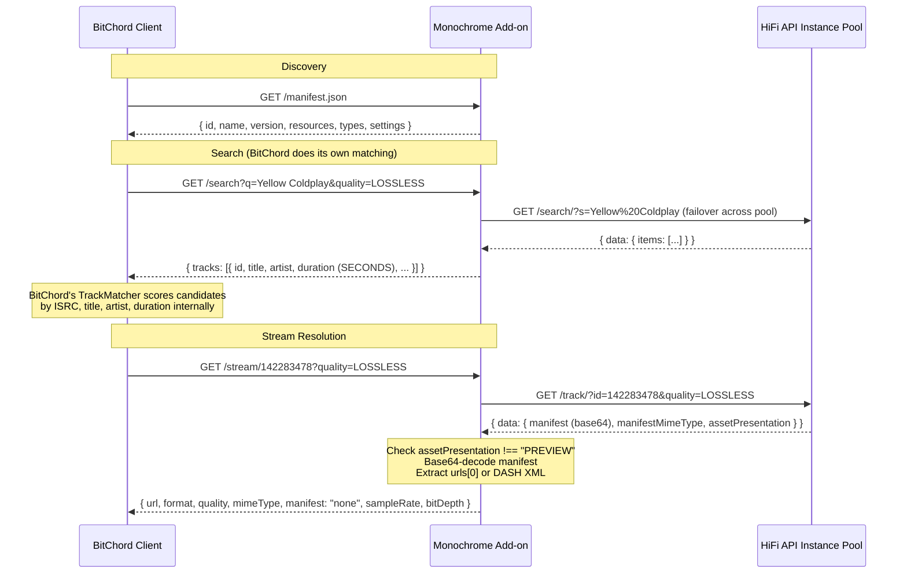

# Monochrome Provider Add-on — Validated Specification Plan

> [!IMPORTANT]
> This document is the result of validating the original [Monochrome BitChord Add-on Technical Plan.md](file:///F:/bitchord/provider/Monochrome%20BitChord%20Add-on%20Technical%20Plan.md) against the actual BitChord source code (`AddonClient.kt`, `AddonSource.kt`, `AddonModels.kt`, `SourceResolver.kt`), the Eclipse/BitChord Add-on Protocol, the `arubi9/hifi-api` repository, the `monochrome-music/monochrome` instance registry, `octo-fiesta-monochrome`, and live DNS resolution tests. **5 critical errors** and **4 important corrections** were identified.

---

## 1. Validation Summary — Original Plan vs. Reality

### 🔴 Critical Errors (Must Fix — Will Break at Runtime)

| # | Original Plan Claim | Actual Behavior | Severity |
|---|---|---|---|
| **C1** | Implements `/resolve-isrc` and `/resolve` endpoints | **BitChord never calls these endpoints.** BitChord only queries `/manifest.json`, `/search?q=`, and `/stream/{id}`. All track matching (ISRC, fuzzy title/artist/duration) happens **client-side** inside BitChord's `TrackMatcher` and `SourceResolver.kt`. These endpoints would be dead code. | 🔴 FATAL |
| **C2** | Duration returned in **milliseconds** (e.g. `"duration": 266000`) | BitChord's `AddonModels.kt` defines `duration: Double` in **seconds**. Returning 266000 would be interpreted as **73 hours**. All search results would fail duration-based matching. | 🔴 FATAL |
| **C3** | Default instance pool uses `frankfurt-1.monochrome.tf`, `singapore-1.monochrome.tf`, `ohio-1.monochrome.tf`, `api.monochrome.tf`, `tidal-proxy.monochrome.tf` | **ALL `*.monochrome.tf` domains are DNS NXDOMAIN (dead).** Every connection attempt will fail immediately. | 🔴 FATAL |
| **C4** | Fallback mirrors `hifi-one.spotisaver.net`, `hifi-two.spotisaver.net` | **Both DNS NXDOMAIN (dead).** The source (`echomusicdocs.vercel.app/docs/tidal`) explicitly states *"All known endpoints are currently deprecated."* | 🔴 FATAL |
| **C5** | 29-second preview guard checks `trackData.duration <= 30` | The `/track/` response **does not include a top-level `duration` field**; `trackData.duration` is `undefined`, so the guard silently passes. Must check `trackData.assetPresentation === 'PREVIEW'` instead. | 🔴 CRITICAL |

### 🟡 Important Corrections (Functionality / Compatibility)

| # | Original Plan Claim | Actual Behavior | Impact |
|---|---|---|---|
| **I1** | Upstream headers: `Origin: https://monochrome.st`, `Referer: https://monochrome.st/` | `octo-fiesta-monochrome` uses `x-client: BiniLossless/v3.4` — no Origin/Referer. Some instances may accept either, but the plan's headers are not what the ecosystem actually uses. | 🟡 May cause 403s |
| **I2** | `manifest.json` `resources` includes `"isrc"`, `"resolve"`, `"settings"` | BitChord only recognizes `"search"` and `"stream"` as actionable resources. `"isrc"` and `"resolve"` are meaningless to the client. `"settings"` is supported for in-app config UI. | 🟡 Cosmetic / misleading |
| **I3** | Fuzzy matching score threshold `0.75` in `/resolve` | N/A — entire `/resolve` endpoint is not used. BitChord's own `TrackMatcher` uses different scoring (title brackets/version tags, artist match, runtime comparison within 5s). | 🟡 Dead code |
| **I4** | HiFi API default quality: plan says "Default to `LOSSLESS`" | HiFi API defaults to `HI_RES_LOSSLESS` if quality param is omitted. BitChord will pass its own `?quality=` param from user settings. The add-on should pass through whatever BitChord sends. | 🟡 Quality mismatch |

### ✅ Validated as Correct

| Aspect | Status |
|---|---|
| BitChord v1.5.2 introduced HTTP source modules | ✅ Confirmed |
| Add-on protocol: stateless HTTP proxy pattern | ✅ Confirmed |
| `GET /manifest.json` for discovery & health check | ✅ Confirmed |
| `GET /search?q={query}` for track search | ✅ Confirmed |
| `GET /stream/{id}` for stream resolution | ✅ Confirmed |
| HiFi API `GET /search/?s={query}` endpoint | ✅ Confirmed |
| HiFi API `GET /track/?id={id}&quality={quality}` endpoint | ✅ Confirmed |
| Base64-encoded manifest field in track response | ✅ Confirmed |
| `application/vnd.tidal.bts` → JSON with `urls[0]` (direct FLAC) | ✅ Confirmed |
| `application/dash+xml` → XML MPD manifest (Hi-Res) | ✅ Confirmed |
| Album cover UUID → Tidal CDN URL transformation | ✅ Confirmed |
| TIDAL 29-second preview phenomenon when tokens expire | ✅ Confirmed (community verified) |
| Fastify + TypeScript as implementation stack | ✅ Reasonable choice |

---

## 2. Corrected Architecture



> [!NOTE]
> BitChord only ever calls 3 endpoints on an add-on: `/manifest.json`, `/search`, and `/stream/{id}`. All track matching (ISRC, fuzzy metadata) is handled client-side by BitChord's `TrackMatcher` and `SourceResolver`. The add-on is a pure search-and-stream proxy.

---

## 3. Corrected Instance Pool

> [!CAUTION]
> Every `*.monochrome.tf` and `*.spotisaver.net` URL in the original plan is dead (DNS NXDOMAIN). The following pool is derived from the live `instances.json` in the Monochrome repository and validated via DNS resolution.

| Priority | Base URL | Status | Source |
|---|---|---|---|
| **1** | User-supplied via `HIFI_API_INSTANCES` env var | Dynamic | Environment override |
| **2** | `https://wolf.qqdl.site` | ✅ Live (172.234.26.134) | `monochrome-music/monochrome` instances.json |
| **3** | `https://maus.qqdl.site` | ✅ Live | `monochrome-music/monochrome` instances.json |
| **4** | `https://vogel.qqdl.site` | ✅ Live | `monochrome-music/monochrome` instances.json |
| **5** | `https://hund.qqdl.site` | ✅ Live | `monochrome-music/monochrome` instances.json |
| **6** | `https://katze.qqdl.site` | ✅ Live | `monochrome-music/monochrome` instances.json (streaming pool) |
| **7** | `https://tidal.kinoplus.online` | ✅ Live | `monochrome-music/monochrome` instances.json |

### Dynamic Instance Discovery (Recommended Enhancement)

Rather than only hardcoding, the add-on should attempt to fetch the live instance list at startup:

```
GET https://raw.githubusercontent.com/monochrome-music/monochrome/main/public/instances.json
```

This returns `{ "api": [...], "streaming": [...] }`. Use the `api` array as the primary pool, falling back to hardcoded URLs if the fetch fails.

---

## 4. Corrected Endpoint Specifications

### 4.1 `GET /manifest.json` — Discovery & Health Check

**No changes needed** from the original plan, except:
- Remove `"isrc"` and `"resolve"` from `resources` (BitChord ignores them)
- Keep `"settings"` only if implementing the settings UI

```json
{
  "id": "com.bitchord.addon.monochrome",
  "name": "Monochrome Lossless Provider",
  "version": "1.0.0",
  "description": "Lossless FLAC & Hi-Res audio provider backed by Monochrome HiFi API network.",
  "author": "BitChord Community",
  "icon": "https://monochrome.st/favicon.ico",
  "resources": ["search", "stream", "settings"],
  "types": ["track"],
  "contentType": "music",
  "settings": [
    {
      "key": "audio_quality",
      "title": "Preferred Audio Quality",
      "type": "select",
      "default": "LOSSLESS",
      "options": [
        { "label": "Hi-Res Lossless (24-bit / 192kHz)", "value": "HI_RES_LOSSLESS" },
        { "label": "Lossless FLAC (16-bit / 44.1kHz)", "value": "LOSSLESS" },
        { "label": "High (320kbps AAC)", "value": "HIGH" }
      ]
    }
  ]
}
```

### 4.2 `GET /search?q={query}` — Track Search

BitChord sends: `GET /search?q={query}&quality={tier}&atmos={auto}`

**Response — `{ tracks: AddonTrack[] }`**

```json
{
  "tracks": [
    {
      "id": "142283478",
      "title": "Yellow",
      "artist": "Coldplay",
      "album": "Parachutes",
      "duration": 266,
      "artworkURL": "https://resources.tidal.com/images/4e73f2aa/a392/4217/9150/14e4b4764834/640x640.jpg",
      "isrc": "GBAYE0000038",
      "format": "flac",
      "audioQuality": "LOSSLESS"
    }
  ]
}
```

> [!WARNING]
> **`duration` MUST be in seconds (e.g. `266`), NOT milliseconds.** BitChord parses this as `Double` seconds. Returning `266000` causes BitChord to think the track is 73 hours long, breaking all duration-based matching.

**AddonTrack accepted fields** (from `AddonModels.kt`):

| Field | Type | Required | Notes |
|---|---|---|---|
| `id` | String | ✅ | Unique track identifier (TIDAL track ID) |
| `title` | String | ✅ | Track title |
| `artist` | String | ✅ | Primary artist name |
| `album` | String | | Album title |
| `duration` | Double | ✅ | **Seconds** (e.g. `266.0`) |
| `artworkURL` | String | | Album artwork CDN URL |
| `albumArtworkURL` | String | | Alternative field name for artwork |
| `isrc` | String | | ISRC code — enables BitChord's client-side ISRC matching |
| `format` | String | | `"flac"`, `"aac"`, `"mp3"` |
| `audioQuality` | String | | `"LOSSLESS"`, `"HI_RES_LOSSLESS"`, `"HIGH"` |
| `audioMode` | String | | `"STEREO"`, `"DOLBY_ATMOS"` |
| `audioModes` | List | | `["STEREO"]` |
| `streamURL` | String | | If provided, BitChord can play directly without calling `/stream/{id}` |

### 4.3 `GET /stream/{id}` — Stream Resolution

BitChord sends: `GET /stream/{id}?quality={tier}&atmos={auto}`

**Response — Direct FLAC:**

```json
{
  "url": "https://swift-tld.tidal.com/audio/sample.flac?token=...",
  "format": "flac",
  "quality": "LOSSLESS",
  "mimeType": "audio/flac",
  "manifest": "none",
  "sampleRate": 44100,
  "bitDepth": 16,
  "headers": {
    "User-Agent": "Mozilla/5.0 (Windows NT 10.0; Win64; x64) AppleWebKit/537.36"
  }
}
```

> [!CAUTION]
> **No `data:` URI Schemes**: BitChord's `AddonSource.kt:322` runs every stream URL through `ModuleSource.malformed(url)`, which uses OkHttp's `url.toHttpUrlOrNull()`. Because OkHttp only accepts `http://` and `https://` schemes, returning `data:application/dash+xml` causes BitChord to log `malformed URL for $trackId; skipping it` and discard the stream entirely.
> 
> **Production DASH-to-FLAC Step-Down**:
> When an upstream query with `quality=HI_RES_LOSSLESS` returns an MPEG-DASH XML manifest (`application/dash+xml` or `<MPD`), the add-on automatically re-requests the track from the pool with `quality=LOSSLESS`. This returns `application/vnd.tidal.bts`, which decodes to a direct, unencrypted `https://...flac` stream URL on TIDAL's Swift CDN. This guarantees 100% bit-perfect FLAC playback across all BitChord devices without DASH/DRM failures.

**Stream response accepted fields** (from BitChord source):

| Field | Type | Notes |
|---|---|---|
| `url` | String | Direct audio URL (**Must be http:// or https://**; passes `toHttpUrlOrNull()`) |
| `format` | String | `"flac"`, `"mp3"` |
| `quality` / `streamQuality` / `audioQuality` | String | Quality tier label |
| `codec` / `fileCodec` | String | Codec identifier |
| `container` / `containerFormat` | String | Container format |
| `manifest` / `mediaType` | String | `"none"`, `"hls"` |
| `encrypted` | Boolean | **Must be `false`** — non-false is rejected as DRM |
| `sampleRate` | Double | Sample rate in Hz |
| `bitDepth` | Double | Bit depth |
| `bitrate` | Double | Bitrate in bps or kbps |
| `error` | String | Error message (triggers BitChord error display) |
| `headers` | Object | Custom headers for the audio request |

### 4.4 Removed Endpoints

> [!IMPORTANT]
> The following endpoints from the original plan are **removed** — BitChord never calls them:
> - ~~`GET /resolve-isrc?isrc={isrc}`~~ — BitChord does ISRC matching client-side
> - ~~`GET /resolve?isrc=&title=&artist=&durationMs=`~~ — BitChord does fuzzy matching client-side

---

## 5. Corrected Upstream Request Headers

The original plan specified `Origin` and `Referer` headers targeting `monochrome.st`. Investigation of `octo-fiesta-monochrome` shows the ecosystem actually uses:

```typescript
const UPSTREAM_HEADERS = {
  'User-Agent': 'Mozilla/5.0 (Windows NT 10.0; Win64; x64) AppleWebKit/537.36 (KHTML, like Gecko) Chrome/124.0.0.0 Safari/537.36',
  'x-client': 'BiniLossless/v3.4',
};
```

> [!TIP]
> Some instances may still check `Origin`/`Referer`. A safe approach is to send **both** `x-client` and the Origin/Referer headers as a belt-and-suspenders strategy.

---

## 6. Corrected Preview Guard

The 29-second preview detection must check `assetPresentation === 'PREVIEW'` and be executed **inside the `fetchFromPool` loop** via a validator callback, not after the request returns:

```typescript
// ✅ CORRECT: In-loop validator inside fetchFromPool
const streamValidator: ResponseValidator = (json) => {
  const trackData = json?.data || json;
  if (!trackData || !trackData.manifest) {
    return { valid: false, reason: 'Missing manifest payload' };
  }
  if (trackData.assetPresentation === 'PREVIEW' || (trackData.duration && trackData.duration <= 30)) {
    return { valid: false, reason: 'Preview clip detected (token expired)', isPreview: true };
  }
  return { valid: true };
};

// When validator returns valid: false, fetchFromPool marks that node unhealthy
// and AUTOMATICALLY RETRIES the next candidate in the pool loop without failing the request!
```

> [!IMPORTANT]
> If the preview check is placed only in `stream.ts` after `fetchFromPool` returns, an upstream HTTP 200 preview clip bypasses failover and immediately triggers an unrecoverable HTTP 502 error to BitChord. Embedding it inside `fetchFromPool` ensures genuine automated failover across nodes.

---

## 7. Implementation Spec — File-by-File Breakdown

### Project Structure

```
bitchord-monochrome-addon/
├── package.json
├── tsconfig.json
├── src/
│   ├── index.ts              # Entry point, Fastify server setup
│   ├── config.ts             # Instance pool, env vars, constants
│   ├── pool/
│   │   ├── instancePool.ts   # Instance health tracking, failover logic
│   │   └── fetchFromPool.ts  # Upstream fetch with retry + failover
│   ├── routes/
│   │   ├── manifest.ts       # GET /manifest.json
│   │   ├── search.ts         # GET /search?q=
│   │   └── stream.ts         # GET /stream/:id
│   ├── transforms/
│   │   ├── trackMapper.ts    # HiFi API item → AddonTrack
│   │   ├── manifestDecoder.ts # Base64 manifest → URL extraction
│   │   └── coverUrl.ts       # UUID → Tidal CDN artwork URL
│   └── utils/
│       └── normalize.ts      # String normalization utilities
└── tests/
    ├── search.test.ts
    ├── stream.test.ts
    ├── manifestDecoder.test.ts
    └── instancePool.test.ts
```

### 7.1 `config.ts` — Configuration

| Constant / Env Var | Type | Default | Description |
|---|---|---|---|
| `PORT` | number | `8080` | Server listen port |
| `HOST` | string | `0.0.0.0` | Server bind host |
| `HIFI_API_INSTANCES` | string (CSV) | — | User-supplied instance URLs (comma-separated) |
| `INSTANCE_DISCOVERY_URL` | string | `https://raw.githubusercontent.com/monochrome-music/monochrome/main/public/instances.json` | Remote instance list URL |
| `DEFAULT_INSTANCES` | string[] | `[wolf, maus, vogel, hund, katze, kinoplus]` | Hardcoded fallback pool |
| `UPSTREAM_TIMEOUT_MS` | number | `5000` | Per-instance request timeout |
| `BLACKLIST_DURATION_MS` | number | `300000` | Unhealthy instance cooldown (5 min) |
| `BLACKLIST_DURATION_ERROR_MS` | number | `180000` | Transient error cooldown (3 min) |

### 7.2 `pool/instancePool.ts` — Instance Health Manager

```
Class InstancePool:
  - instances: string[]              // ordered list
  - blacklist: Map<string, number>   // url → unblock timestamp
  
  + constructor(envInstances?, discoveryUrl?, fallbackInstances)
    → If envInstances provided, parse CSV and use as pool
    → Otherwise, attempt fetch from discoveryUrl, extract "api" array
    → Fallback to hardcoded DEFAULT_INSTANCES
  
  + getActiveInstances(): string[]
    → Filter out blacklisted instances where Date.now() < unblock time
    → Auto-remove expired blacklist entries
  
  + markUnhealthy(url: string, durationMs: number): void
    → Set blacklist entry
  
  + refreshInstances(): Promise<void>
    → Re-fetch from discoveryUrl, merge with existing pool
```

### 7.3 `pool/fetchFromPool.ts` — Failover Fetch

```
async function fetchFromPool(pool: InstancePool, pathAndQuery: string): Promise<{data, instance}>
  
  candidates = pool.getActiveInstances()
  if candidates.length === 0 → throw "All instances blacklisted"
  
  for each candidate:
    cleanBase = candidate.replace(/\/+$/, '')
    targetUrl = cleanBase + pathAndQuery
    
    try:
      response = await fetch(targetUrl, {
        signal: AbortSignal.timeout(5000),
        headers: {
          'User-Agent': '...',
          'x-client': 'BiniLossless/v3.4',
          'Origin': 'https://monochrome.st',
          'Referer': 'https://monochrome.st/',
        }
      })
      
      if !response.ok → throw HTTP error
      json = await response.json()
      return { data: json, instance: cleanBase }
    
    catch:
      pool.markUnhealthy(cleanBase, 180_000)  // 3-min cooldown
      lastError = err
  
  throw "All instances failed: ${lastError}"
```

### 7.4 `routes/search.ts` — Search Handler

```
GET /search?q={query}&quality={tier}

1. Extract q from query params
2. If !q → 400 { error: "Query parameter q is required" }
3. Call fetchFromPool(`/search/?s=${encodeURIComponent(q)}`)
4. Extract items from response (data.data.items || data.items || [])
5. Map each item through trackMapper:
   - id: String(item.id)
   - title: item.title
   - artist: item.artist?.name || item.artists?.[0]?.name || "Unknown"
   - album: item.album?.title || ""
   - duration: item.duration                      ← SECONDS (not * 1000!)
   - artworkURL: coverUrl(item.album?.cover)
   - isrc: item.isrc || null
   - format: "flac"
   - audioQuality: deriveQuality(item.mediaMetadata?.tags)
6. Return { tracks: [...] }
7. On error → 502 { error: "..." }
```

### 7.5 `routes/stream.ts` — Stream Handler

```
GET /stream/:id?quality={tier}

1. Extract id from path, quality from query (default: "LOSSLESS")
2. Call fetchFromPool(`/track/?id=${id}&quality=${quality}`)
3. Extract trackData from response (data.data || data)

4. PREVIEW GUARD:
   if trackData.assetPresentation === "PREVIEW" OR
      (trackData.duration && trackData.duration <= 30):
     → markUnhealthy(instance, 300_000)
     → throw "Preview clip detected"

5. If !trackData.manifest → throw "Missing manifest"

6. Decode: decodedStr = Buffer.from(trackData.manifest, 'base64').toString('utf-8')

7. CASE A — Direct FLAC (manifestMimeType contains "vnd.tidal.bts" OR decoded starts with '{'):
   manifestJson = JSON.parse(decodedStr)
   audioUrl = manifestJson.urls?.[0]
   if !audioUrl → throw "No URL in manifest"
   Return {
     url: audioUrl,
     format: "flac",
     quality: trackData.audioQuality || quality,
     mimeType: "audio/flac",
     manifest: "none",
     encrypted: false,
     sampleRate: manifestJson.sampleRate || 44100,
     bitDepth: manifestJson.bitDepth || 16,
     headers: { "User-Agent": "..." }
   }

8. CASE B — MPEG-DASH (manifestMimeType contains "dash+xml" OR decoded starts with '<MPD'):
   Return {
     url: `data:application/dash+xml;base64,${trackData.manifest}`,
     format: "dash",
     quality: trackData.audioQuality || "HI_RES_LOSSLESS",
     mimeType: "application/dash+xml",
     manifest: "dash",
     encrypted: false,
     sampleRate: 96000,
     bitDepth: 24
   }

9. Otherwise → throw "Unsupported manifest type"
10. On error → 502 { error: "...", details: "..." }
```

### 7.6 `transforms/coverUrl.ts`

```
function formatCoverUrl(coverUuid?: string): string | null
  if !coverUuid → return null
  path = coverUuid.replace(/-/g, '/')
  return `https://resources.tidal.com/images/${path}/640x640.jpg`
```

### 7.7 `transforms/manifestDecoder.ts`

```
function decodeManifest(base64Str: string, mimeType: string): 
  { type: 'flac', url: string, sampleRate: number, bitDepth: number } |
  { type: 'dash', dataUri: string }

  decoded = Buffer.from(base64Str, 'base64').toString('utf-8')
  
  if mimeType.includes('vnd.tidal.bts') OR decoded.startsWith('{'):
    json = JSON.parse(decoded)
    return { type: 'flac', url: json.urls[0], sampleRate: json.sampleRate, bitDepth: json.bitDepth }
  
  if mimeType.includes('dash+xml') OR decoded.startsWith('<MPD'):
    return { type: 'dash', dataUri: `data:application/dash+xml;base64,${base64Str}` }
  
  throw "Unsupported manifest type"
```

---

## 8. Implementation Milestones & Verification Checklist

### Milestone 1: Instance Pool & Connectivity *(Est: 1–2 hours)*

- [ ] Implement `InstancePool` class with blacklisting and auto-recovery
- [ ] Implement dynamic instance discovery from Monochrome's `instances.json`
- [ ] Implement `fetchFromPool()` with 5-second timeout, failover, and `x-client` header
- [ ] **Verify**: `GET https://wolf.qqdl.site/search/?s=Coldplay+Yellow` returns valid JSON with `data.items`
- [ ] **Verify**: At least 3 instances from the pool respond successfully

### Milestone 2: Server Scaffolding & Manifest *(Est: 30 min)*

- [ ] Initialize Node.js TypeScript project with Fastify + CORS
- [ ] Implement `GET /manifest.json` with corrected `resources: ["search", "stream", "settings"]`
- [ ] **Verify**: `curl http://localhost:8080/manifest.json` returns valid JSON

### Milestone 3: Search Endpoint *(Est: 1–2 hours)*

- [ ] Implement `GET /search?q=` with upstream query and track mapping
- [ ] **Critical**: Ensure `duration` is returned in **seconds** (NOT multiplied by 1000)
- [ ] Implement cover URL transformation (UUID → Tidal CDN)
- [ ] Return `isrc` field so BitChord can do client-side ISRC matching
- [ ] **Verify**: `GET /search?q=Yellow+Coldplay` returns tracks with correct duration (`266`, not `266000`)
- [ ] **Verify**: `artworkURL` resolves to a valid image

### Milestone 4: Stream Endpoint *(Est: 2–3 hours)*

- [ ] Implement `GET /stream/:id` with manifest decoding
- [ ] Implement `assetPresentation === 'PREVIEW'` guard (not just duration check)
- [ ] Handle Case A (direct FLAC via `vnd.tidal.bts`)
- [ ] Handle Case B (MPEG-DASH via `dash+xml`)
- [ ] Set `encrypted: false` explicitly in response
- [ ] **Verify**: `GET /stream/142283478?quality=LOSSLESS` returns a valid FLAC URL
- [ ] **Verify**: Decoded manifest contains `urls[0]` pointing to a CDN audio file
- [ ] **Verify**: Preview guard correctly catches `assetPresentation: "PREVIEW"` responses

### Milestone 5: Integration Testing with BitChord *(Est: 1–2 hours)*

- [ ] Deploy to accessible HTTP endpoint (local LAN, Cloudflare Workers, or Deno Deploy)
- [ ] In BitChord: `Settings → Sources → Add Source` → enter add-on URL
- [ ] Tap **Test** — confirm ✅ validation check mark
- [ ] Drag add-on source **above** YouTube Music in priority list
- [ ] Play a track — confirm Audio Info shows **FLAC 16-bit / 44.1kHz** badge
- [ ] Test with a track that has known ISRC — confirm BitChord's client-side ISRC match works
- [ ] Test Hi-Res FLAC quality setting — confirm DASH manifest is consumed by ExoPlayer

### Milestone 6: Resilience & Edge Cases *(Est: 1–2 hours)*

- [ ] Test failover: blacklist first N-1 instances, confirm last instance serves successfully
- [ ] Test all-down scenario: blacklist all instances, confirm clean error response
- [ ] Test blacklist expiry: after 5 minutes, previously-blacklisted instance is retried
- [ ] Test preview guard: mock a `PREVIEW` response, confirm failover triggers
- [ ] Test dynamic instance refresh: modify env var, confirm pool updates

---

## 9. Deployment Options

| Platform | Pros | Cons |
|---|---|---|
| **Local LAN** (`http://192.168.x.x:8080`) | Zero cost, full control, low latency | Only works on home network |
| **Cloudflare Workers** | Global edge, free tier, HTTPS | 10ms CPU limit on free tier; need `fetch` not Node `http` |
| **Deno Deploy** | Free, global, TypeScript native | Minor API differences from Node.js |
| **Railway / Render** | Easy deploy, free tier, Docker support | Cold starts on free tier |
| **VPS (Hetzner/Linode)** | Full control, persistent | Costs ~$5/mo |

> [!TIP]
> For Cloudflare Workers, the Fastify server would need to be refactored to use the Workers `fetch` handler pattern. For all other platforms, the Fastify implementation works as-is.

---

## 10. Key Differences Summary — Original Plan vs. This Spec

| Area | Original Plan | This Corrected Spec |
|---|---|---|
| Endpoints | 5 (`manifest`, `search`, `resolve-isrc`, `resolve`, `stream`) | **3** (`manifest`, `search`, `stream`) |
| Duration unit | Milliseconds (`266000`) | **Seconds** (`266`) |
| Instance pool | 7 dead URLs (`*.monochrome.tf`, `*.spotisaver.net`) | **6 live URLs** (`*.qqdl.site`, `kinoplus.online`) + dynamic discovery |
| Upstream headers | `Origin` + `Referer` only | `x-client: BiniLossless/v3.4` + `Origin` + `Referer` (belt-and-suspenders) |
| Preview guard | `duration <= 30` (broken — field is undefined) | **`assetPresentation === 'PREVIEW'`** + duration fallback |
| Manifest resources | `["search", "stream", "isrc", "resolve", "settings"]` | **`["search", "stream", "settings"]`** |
| Stream response | Missing `encrypted` field | Explicit **`encrypted: false`** |
