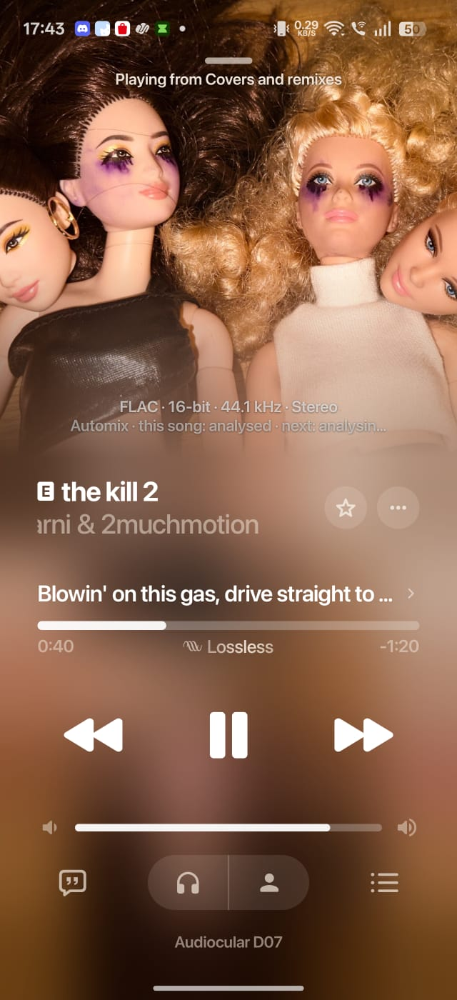

# Monochrome Lossless Provider Add-on for BitChord

[](https://github.com/acedreamer/bitchord-monochrome-addon/actions/workflows/ci.yml)
[](Dockerfile)
[](LICENSE)
[](https://nodejs.org/)

A high-performance, stateless HTTP source provider add-on for [BitChord](https://github.com/bitchord) (v1.5.2+), translating BitChord client requests to the community Monochrome / HiFi API network to deliver bit-perfect lossless 16-bit/44.1kHz FLAC and Hi-Res audio streams.

<p align="center">
  
  
  
</p>

---

## 🌐 Public Live Instance

A live instance is hosted and ready for community use:

| Provider URL | Hosted Region | Latency Advantage |
|---|---|---|
| `https://bitchord-monochrome-addon.onrender.com` | **Singapore (`singapore`)** | ⚡ **Significantly lower latency (~40–60ms)** for users in India, Southeast Asia, and neighboring APAC regions compared to distant US/EU servers |

> [!TIP]
> **Quick Setup in BitChord:**
> 1. Open **BitChord** on your device > **Settings** > **Source Modules** / **Add-ons**.
> 2. Tap **Add Custom Provider** (`+`).
> 3. Paste `https://bitchord-monochrome-addon.onrender.com` and tap **Save**.

---

## 🚀 1-Click Cloud Deploy

Deploy your own private instance in seconds with zero configuration:

[](https://render.com/deploy?repo=https://github.com/acedreamer/bitchord-monochrome-addon)
[](https://railway.app/template?template=https%3A%2F%2Fgithub.com%2Facedreamer%2Fbitchord-monochrome-addon)

---

## ⚡ Core Features & Architectural Guarantees

- **Strict 3-Endpoint BitChord Protocol**: Implements `GET /manifest.json`, `GET /search`, and `GET /stream/:id`. All candidate scoring and fuzzy/ISRC matching are delegated to BitChord's native client-side `TrackMatcher`.
- **In-Loop 29-Second Preview Failover**: Automatically detects expired upstream tokens (`assetPresentation === "PREVIEW"` or 30-second clips) inside the request loop, blacklists the offending node for 5 minutes, and retries the next candidate in the pool transparently.
- **Automatic DASH-to-FLAC Step-Down**: When an upstream query returns MPEG-DASH XML, the provider automatically steps down to query `quality=LOSSLESS` to extract direct, unencrypted `https://...flac` stream URLs on TIDAL's Swift CDN with `encrypted: false`, avoiding `toHttpUrlOrNull()` rejection in ExoPlayer.
- **Accurate Duration in Seconds**: Preserves track duration strictly in **seconds (floating point / double)** as required by BitChord's `AddonModels.kt`, preventing duration mismatch failures.
- **Appended Dynamic Discovery**: Discovers live HiFi API nodes from the Monochrome registry at startup and appends them behind verified Priority 1 nodes, preventing unverified node latency.
- **ESM NodeNext & Production Docker**: 100% TypeScript ESM compliance with strict `.js` imports and multi-stage Docker builds.

---

## 📱 BitChord Client Setup Guide

Follow the instructions below depending on whether you are running the add-on locally on your computer or deployed to the cloud:

### Scenario A: Running Locally on your PC (Testing on Phone via Wi-Fi)

1. Start the add-on server on your PC:
   ```bash
   npm run dev
   # or for production: npm run build && npm start
   ```
2. Find your computer's local IP address on your Wi-Fi network:
   - **Windows**: Run `ipconfig` in Command Prompt / PowerShell and look for **IPv4 Address** under your Wi-Fi adapter (e.g. `192.168.1.100` or `192.168.20.6`).
   - **macOS / Linux**: Run `ip a` or `ifconfig`.
3. Ensure your phone is connected to the **same Wi-Fi network**.
4. Test connectivity from your phone: Open Chrome / Safari on your phone and browse to:
   ```text
   http://<YOUR_PC_IP>:8080/manifest.json
   ```
   *(e.g., `http://192.168.20.6:8080/manifest.json`)*
5. Open **BitChord** on your phone:
   - Navigate to **Settings** > **Source Modules** / **Add-ons**.
   - Tap **Add Custom Provider** (`+`).
   - Enter your PC's URL:
     ```text
     http://<YOUR_PC_IP>:8080
     ```
   - Tap **Save** / **Add**. BitChord will handshake via `GET /manifest.json` and register **Monochrome Lossless Provider**!

> [!IMPORTANT]
> **Mobile Configuration Tips:**
> - **Always include the `http://` prefix!** If you enter `192.168.x.x:8080` without `http://`, Android treats the string as a domain name and fails with `No address associated with hostname`.
> - **Never use `localhost` on a phone.** `localhost` on a phone refers to the phone itself, not your computer.
> - **Windows Firewall:** If your phone cannot connect, Windows Firewall may be blocking inbound traffic on port 8080. Run this command in an Administrator PowerShell to allow it:
>   ```powershell
>   New-NetFirewallRule -DisplayName "BitChord Addon" -Direction Inbound -LocalPort 8080 -Protocol TCP -Action Allow
>   ```

---

### Scenario B: Running on the Same Device (BitChord Desktop or Emulator)

| Platform | Provider URL to Enter |
|---|---|
| **BitChord Desktop** (Windows / macOS / Linux) | `http://localhost:8080` |
| **Android Emulator** (Android Studio) | `http://10.0.2.2:8080` |

---

### Scenario C: Deployed to Cloud (Render / Railway / VPS)

1. Deploy using the [1-Click Cloud Deploy](#-1-click-cloud-deploy) buttons above.
2. In **BitChord**, enter your cloud service HTTPS URL:
   ```text
   https://<your-service-name>.onrender.com
   ```
3. No local network or firewall setup is needed.

---

## 🔧 Environment Variables

| Variable | Default | Description |
|---|---|---|
| `PORT` | `8080` | Port for the Fastify HTTP server to listen on. |
| `HOST` | `0.0.0.0` | Host interface to bind. |
| `HIFI_API_INSTANCES` | *(Internal verified pool)* | Comma-separated list of HiFi API node URLs (takes Priority 1). |

---

## 📡 API Specification

### 1. `GET /manifest.json`
Returns add-on metadata and configuration declaration for BitChord discovery.
```json
{
  "id": "com.bitchord.addon.monochrome",
  "name": "Monochrome Lossless Provider",
  "version": "1.0.0",
  "description": "Lossless FLAC & Hi-Res audio provider backed by Monochrome HiFi API network.",
  "author": "BitChord Community",
  "icon": "https://monochrome.st/favicon.ico",
  "resources": ["search", "stream", "settings"],
  "types": ["track"],
  "contentType": "music",
  "settings": [
    {
      "key": "audio_quality",
      "title": "Preferred Audio Quality",
      "type": "select",
      "default": "LOSSLESS",
      "options": [
        { "label": "Hi-Res Lossless (24-bit / 192kHz)", "value": "HI_RES_LOSSLESS" },
        { "label": "Lossless FLAC (16-bit / 44.1kHz)", "value": "LOSSLESS" },
        { "label": "High (320kbps AAC)", "value": "HIGH" }
      ]
    }
  ]
}
```

### 2. `GET /search?q={query}&quality={quality}`
Searches upstream tracks and maps them to BitChord's track schema.
```json
{
  "tracks": [
    {
      "id": "142283478",
      "title": "Yellow",
      "artist": "Coldplay",
      "album": "Parachutes",
      "duration": 266,
      "artworkURL": "https://resources.tidal.com/images/4e73f2aa/a392/4217/9150/14e4b4764834/640x640.jpg",
      "format": "flac",
      "audioQuality": "LOSSLESS",
      "isrc": "GBAYE0000038"
    }
  ]
}
```

### 3. `GET /stream/:id?quality={quality}`
Resolves a direct stream URL for playback.
```json
{
  "url": "https://swift-tld.tidal.com/audio/sample.flac?token=...",
  "format": "flac",
  "quality": "LOSSLESS",
  "mimeType": "audio/flac",
  "manifest": "none",
  "encrypted": false,
  "sampleRate": 44100,
  "bitDepth": 16,
  "headers": {
    "User-Agent": "Mozilla/5.0 ..."
  }
}
```

---

## 🛠 Local Development

```bash
# Clone the repository
git clone https://github.com/acedreamer/bitchord-monochrome-addon.git
cd bitchord-monochrome-addon

# Install dependencies
npm install

# Start in development mode with live-reloading
npm run dev

# Run automated test suite
npm test

# Run live integration test against upstream instances
npm run test:live

# Type-check and build
npm run typecheck
npm run build
```

---

## 🐳 Docker Deployment

```bash
# Build the container
docker build -t bitchord-monochrome-addon .

# Run container
docker run -d -p 8080:8080 --name bitchord-monochrome-addon bitchord-monochrome-addon
```

Or using Docker Compose:
```bash
docker compose up -d
```

---

## 📄 License

This project is licensed under the MIT License - see the [LICENSE](LICENSE) file for details.
